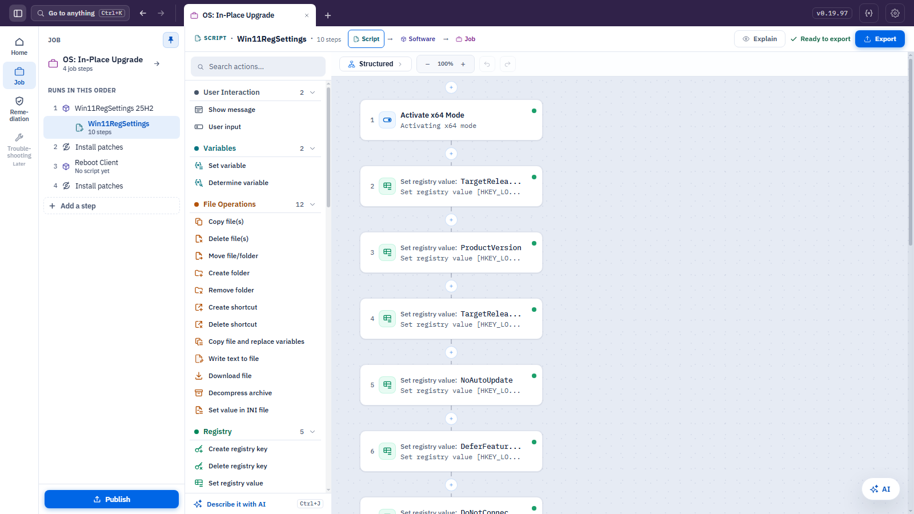
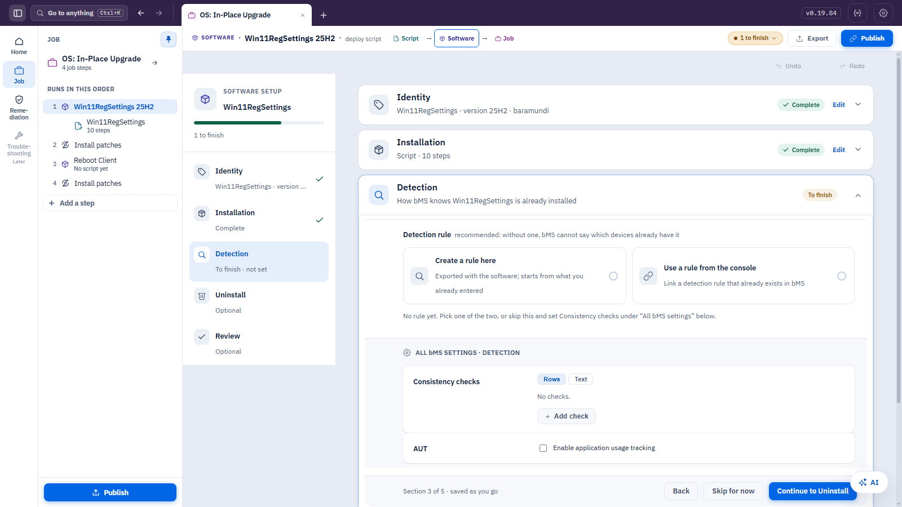

# Action Composer

Action Composer is a community project by baramundi colleagues. It is **not an official
baramundi product**, and baramundi support does not cover it.

It is a visual editor for baramundi deployments: you build the steps of a deployment on a
canvas or in a table, and it writes the script and packages it for baramundi Management
Suite (bMS).

> Status: **preview**. Expect changes between releases.

## What it does

- **Build a deployment script visually.** Add steps, set conditions, and arrange them as a
  table (Classic) or as a graph (Structured). Both views show the same script.
- **Package it as Software and Job.** Turn the script into a Software object and a Job
  with sensible defaults, and change only what you need.
- **Export for bMS.** Save a `.bds` script or a `.bdx` container that you import into bMS.
  Exporting again keeps the same identities, so bMS updates the objects instead of
  creating duplicates.
- **Open existing work.** Import a `.bds` or `.bdx`, edit it, and export it again.

## Install

1. Open the [latest release](../../releases/latest).
2. Download the installer and run it.

## Requirements

- Windows.
- baramundi Management Suite, to import what you export.

What each feature needs, and which hosts to allow in a restricted network: [Requirements](docs/REQUIREMENTS.md).

## Questions

See the [FAQ](docs/FAQ.md).

## Source code

The source code will follow, under the Apache License 2.0.
